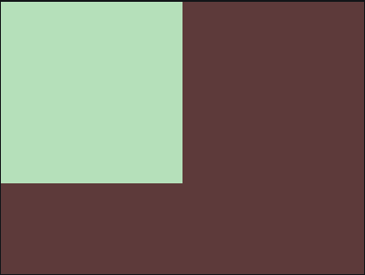

# #1 Simply Square

**Battle 1 · Challenge 1** · [Play on CSSBattle](https://cssbattle.dev/play/1)

| Score |
|-------|
| 601.42 |

## Target

## Approach

- `*` resets the default margin and sets the dark brown background (`#5d3a3a`) on everything.
- A single `div` of 200×200px with `#b5e0ba` sits in the top-left corner.
