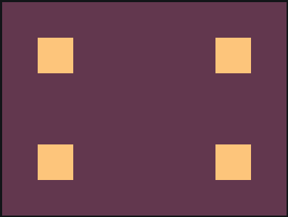

# #2 Carrom

**Battle 1 · Challenge 2** · [Play on CSSBattle](https://cssbattle.dev/play/2)

| Score |
|-------|
| 600.04 |

## Target

## Approach

- `*` resets margins and sets the purple background (`#62374e`).
- `body` is a flex row with `50px` padding and `justify-content: space-between`, which pushes the two column containers to the left and right edges.
- Each `.container` is a flex column with `space-between`, which places its two squares at the top and bottom.
- Each `.small-div` is a 50×50 square in `#fdc57b`. Unitless `50` works here because CSSBattle renders in quirks mode.
