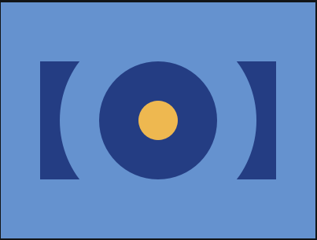

# #3 Push Button

**Battle 1 · Challenge 3** · [Play on CSSBattle](https://cssbattle.dev/play/3)

| Score |
|-------|
| 600.6 |

## Target

## Approach

- `*` resets margins and sets the light blue background (`#6592CF`). `body` is a flex container that centers everything.
- `.container` is a 300×150 dark blue (`#243D83`) rectangle that forms the two side "brackets".
- `.outer-circle` is a 150×150 circle with a transparent background and a `50px` light blue border, 250px across in total. The border cuts the curved gap out of the dark rectangle. The transparent center lets the dark blue show through, which makes the middle disc. The parts above and below the rectangle blend into the page background.
- `.inner-circle` is a 50×50 yellow (`#EEB850`) dot. It's `position: absolute`, and the flex centering of its parent keeps it in the middle.
