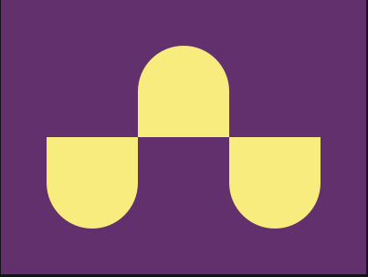

# #4 Ups n Downs

**Battle 1 · Challenge 4** · [Play on CSSBattle](https://cssbattle.dev/play/4)

| Score |
|-------|
| 600.71 |

## Target

## Approach

- `*` resets margins and sets the purple background (`#62306D`). `body` gets `50px` padding to inset the shapes.
- The layout is split into two flex rows, `.up-container` and `.down-container`, each taking half the height.
- The top row centers one 100×100 yellow (`#F7EC7D`) block with `border-radius: 50px 50px 0 0`, which rounds its top into an arch.
- The bottom row uses `space-between` to push two blocks to the left and right edges, with `border-radius: 0 0 50px 50px` rounding their bottoms.
- Because the rows stack directly, the top shape's flat base lines up with the bottom shapes' flat tops, which gives the zig-zag look.
