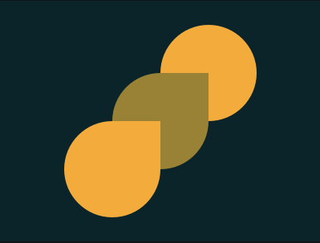

# #5 Acid Rain

**Battle 1 · Challenge 5** · [Play on CSSBattle](https://cssbattle.dev/play/5)

| Score |
|-------|
| 600.37 |

## Target

## Approach

- `*` resets margins and sets the dark teal background (`#0B2429`). `body` is a flex container that centers the middle shape.
- The drop shape is a 120×120 square with `border-radius: 50% 0 50% 50%`. Every corner is rounded except the top-right, which stays sharp and forms the drop's tip.
- `.middle` is the olive (`#998235`) drop, centered by flexbox.
- `.top` is an orange (`#F3AC3C`) drop positioned with `top: 50%; right: 50%`, so its top-right tip sits at the canvas center (the bottom-left drop in the image). `z-index: 2` puts it in front of the middle drop.
- `.bottom` is a full orange circle positioned with `bottom: 50%; left: 50%`, so its bottom-left corner sits at the canvas center (the top-right circle in the image). The middle drop overlaps it.
