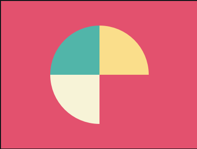

# #6 Missing Slice

**Battle 1 · Challenge 6** · [Play on CSSBattle](https://cssbattle.dev/play/6)

| Score |
|-------|
| 600.38 |

## Target

## Approach

- `body` has the pink background (`#E3516E`) and uses flexbox to center the shape.
- `.container` is a 200×200 square laid out as a 2×2 CSS grid. `border-radius: 50%` with `overflow: hidden` clips it into a circle, so each 100×100 cell becomes a quarter-circle slice.
- The cells are filled teal (`#51B5A9`), yellow (`#FADE8B`) and cream (`#F7F3D7`), and the fourth is `transparent`. The background shows through it as the "missing slice".
