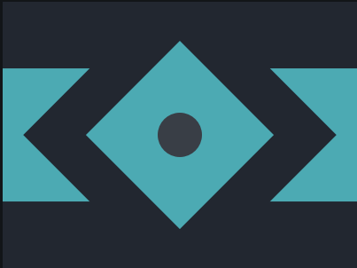

# #9 Tesseract

**Battle 1 · Challenge 9** · [Play on CSSBattle](https://cssbattle.dev/play/9)

| Score (this code) | High score |
|-------------------|------------|
| 600.46 | 600.74 |

## Target

## Approach

- `*` resets margins and sets the dark background (`#222730`). `body` is a flex container that centers everything.
- `.container` is a full-width, 150px-tall teal band (`#4CAAB3`) across the middle of the canvas. It also uses flexbox to center its children.
- `.inner-container` is a 150×150 teal square with a 50px dark border, rotated 45°. The dark border forms the diamond outline that cuts into the band, and the teal fill forms the inner diamond. `backface-visibility: hidden` smooths the edges of the rotated square.
- `.circle` is a 50×50 gray (`#393E46`) circle, absolutely positioned and centered by the flex parent, so it sits in the middle of the diamond.
